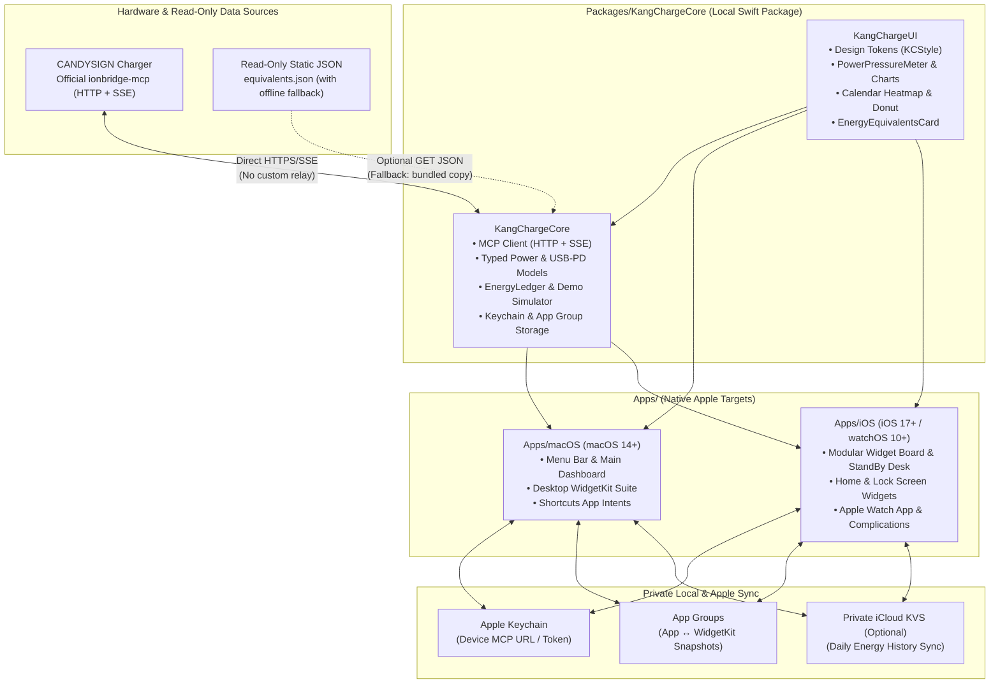

# SugarWatt Architecture & How It Works

SugarWatt is a unified Apple-native monorepo containing the shared Swift Package (`Packages/KangChargeCore`) alongside the macOS (`Apps/macOS`) and iOS + watchOS (`Apps/iOS`) applications.

---

## 1. Architecture Diagram

---

## 2. How It Works (运行原理)

### 2.1 Direct Charger Communication (Zero Custom Backend)
1. **Local Keychain Storage**: Pasting your charger's MCP URL (or full prompt text copied from the CANDYSIGN app) extracts the `/sse` endpoint and stores it strictly locally in the **Apple Keychain**. There are no user accounts and no third-party relay servers.
2. **HTTP + SSE MCP Client**: `KangChargeCore` talks directly to your charger's `ionbridge-mcp` endpoint to stream per-port watts, voltage, current, fast-charge protocol, cable E-Marker specs, chip temperature, and USB-PD battery state, as well as execute safe port controls.
3. **Offline Demo Mode**: Without hardware connected, the local simulator inside `KangChargeCore` drives realistic live multi-port telemetry across all views and widgets.

### 2.2 Daily Energy Ledger & Cross-Device Sync
1. **Hardware Counter Tracking**: `EnergyLedger` integrates the charger's hardware `session_charge_mwh` counter into daily, per-port, hourly, and weekday totals.
2. **App Group Snapshots**: Live snapshots and energy summaries are shared with WidgetKit and Apple Watch via App Groups so widgets stay fresh without opening extra network sessions.
3. **Optional Private iCloud KVS**: Daily energy history optionally syncs between your Mac and iPhone through Apple's private `NSUbiquitousKeyValueStore`.

### 2.3 Lightweight Static JSON for Energy Equivalents
Energy equivalent comparisons are backed by a simple read-only JSON catalog ([`LeiZiKang/sugarwatt-equivalents`](https://github.com/LeiZiKang/sugarwatt-equivalents)) with an identical bundled offline fallback inside `KangChargeCore`:

| ID | SF Symbol | `kwhPerUnit` | English | 简体中文 |
| --- | --- | ---: | --- | --- |
| `iphone_charge` | `iphone` | `0.017` | iPhone 16 Pro charges | 台 iPhone 充满电 |
| `espresso` | `cup.and.saucer.fill` | `0.025` | Cups of espresso brewed | 杯意式浓缩咖啡 |
| `macbook_charge` | `laptopcomputer` | `0.070` | MacBook Pro full charges | 次 MacBook Pro 满充 |
| `kettle_boil` | `flame.fill` | `0.110` | 1L kettles boiled | 壶 1L 烧开的热水 |
| `ev_km` | `car.fill` | `0.145` | EV highway range | 电动车续航里程 |
| `laundry` | `washer.fill` | `0.850` | Loads of laundry | 桶滚筒洗衣机清洗 |

Want to suggest a new comparison? Open a Pull Request on [sugarwatt-equivalents](https://github.com/LeiZiKang/sugarwatt-equivalents)!
