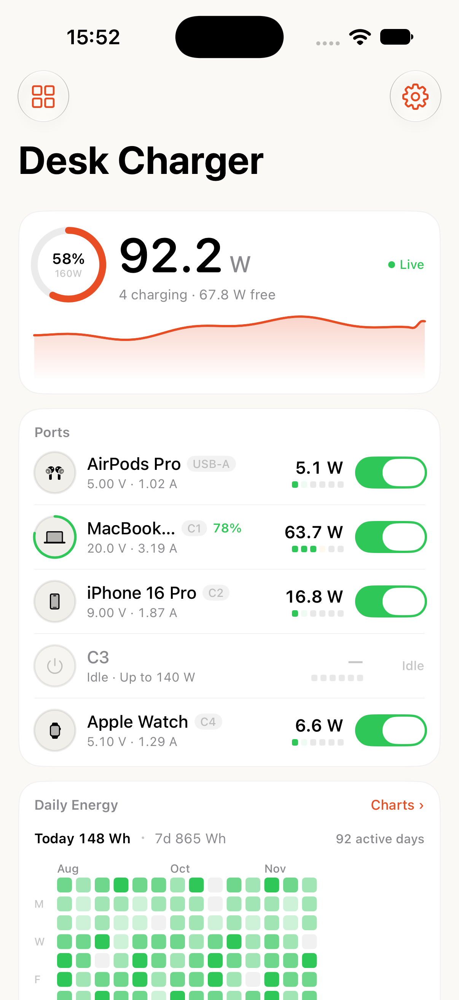
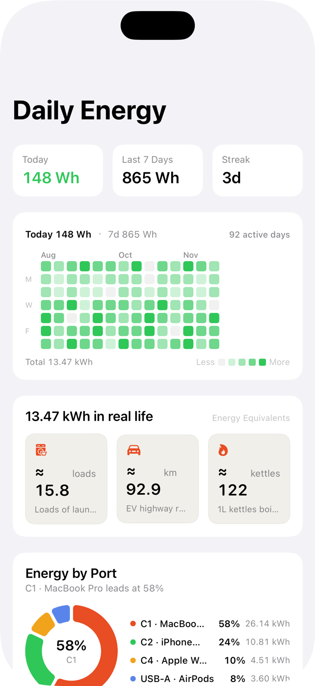
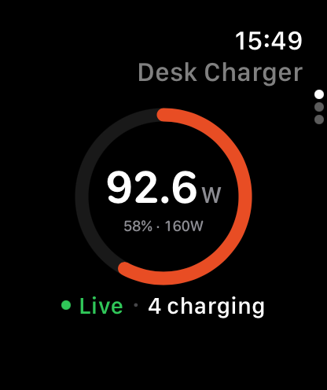
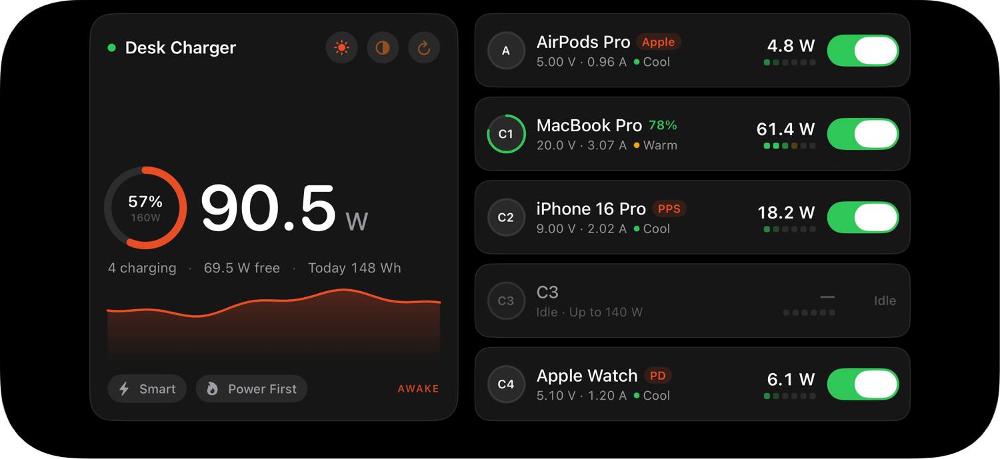

<div align="center">

# 📱 SugarWatt for iOS & watchOS

**Apple-native iPhone & Apple Watch companion app, StandBy-style Landscape Desk Dashboard, modular `1×1` / `2×1` Widget Board, and WidgetKit suite for CANDYSIGN (制糖工厂) CoCan smart chargers.**

[← Back to SugarWatt Monorepo](../../README.md) · [macOS App](../macOS/README.md) · [Shared SPM (`KangChargeCore`)](../../Packages/KangChargeCore/README.md) · [Architecture](../../ARCHITECTURE.md)

</div>

---

Free on the App Store and 100% open source under the MIT License. Powered by the local shared [`KangChargeCore`](../../Packages/KangChargeCore) Swift Package (`KangChargeCore` + `KangChargeUI`).

## Visual Tour

| iPhone Live Dashboard | Daily Energy Analytics | Apple Watch Companion |
| :---: | :---: | :---: |
|  |  |  |

<p align="center">
  
</p>

## Features

- **Modular `1×1` & `2×1` Widget Board**: Long-press any tile to enter SpringBoard-style edit mode with jiggle, haptics, and live auto-reflow drag-and-drop.
- **Hardware LED Pressure Meters & USB-PD Battery Rings**: 8-segment breathing load meters alongside real USB-PD device battery rings and 180-sample device memory logs.
- **StandBy Landscape Desk Dashboard**: Rotate your iPhone sideways for an always-on OLED charging monitor — switch the right panel between all 5 live ports, your Daily Energy Calendar Heatmap, or your custom widget grid.
- **Daily Energy Analytics**: GitHub-style Calendar Heatmap with month & weekday labels, Energy Equivalents, Port Breakdown Donut Chart, and By Hour / By Weekday Charging Rhythm, with optional private iCloud KVS sync to macOS.
- **One-Tap Smart MCP Paste & Offline Demo Mode**: Paste the full prompt text copied from the CANDYSIGN app to auto-extract your `/sse` endpoint, or enable Demo Mode to explore every view offline without hardware.
- **Home & Lock Screen Widgets + Redesigned Apple Watch App**: Circular load rings, LED meters, 3-page Digital Crown watchOS app, and 4 watch face complications.
- **Xcode Cloud Ready**: Includes `ci_scripts/ci_post_clone.sh` — see [docs/XCODE_CLOUD.md](docs/XCODE_CLOUD.md).

## Requirements

- iOS 17+ / watchOS 10+
- A Wi-Fi connected CANDYSIGN CoCan charger (or use built-in **Demo Mode** without hardware)
- To build from source: Xcode 16+ and [XcodeGen](https://github.com/yonaskolb/XcodeGen)

## Build from Source

```bash
git clone https://github.com/LeiZiKang/SugarWatt.git
cd SugarWatt/Apps/iOS
brew install xcodegen
cp Config/Local.xcconfig.example Config/Local.xcconfig
```

Fill in your `DEVELOPMENT_TEAM` and `BUNDLE_ID_PREFIX` in `Config/Local.xcconfig` (ensure your developer account has App Groups `group.<prefix>.kangcharge` and `group.<prefix>.kangcharge.watch`), then generate and open the project (resolves `../../Packages/KangChargeCore` locally):

```bash
xcodegen generate
open KangChargeiOS.xcodeproj
```

## Privacy & Security

- Your MCP server URL is stored strictly in the iOS/watchOS **Apple Keychain** (shared only with your own widgets).
- Daily energy history is stored locally in your App Group and optionally synced only via your private Apple iCloud Key-Value Store.
- No custom relay servers, no user accounts, no ads, and no third-party analytics.

## License

[MIT](../../LICENSE)
