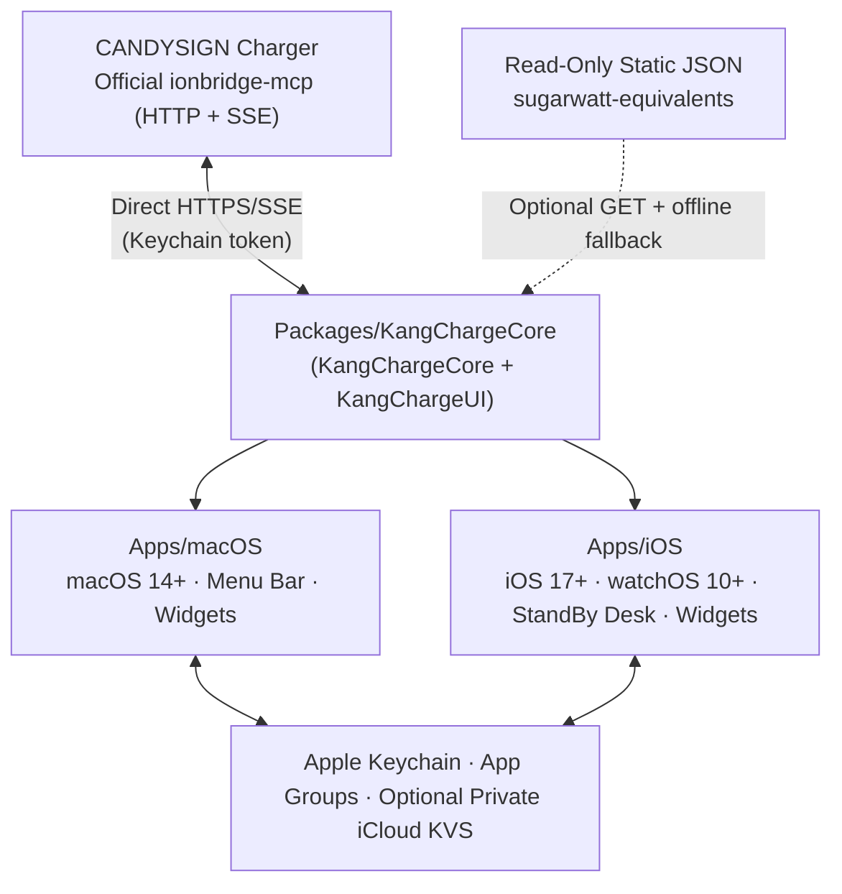

# SugarWatt

**Apple-native macOS, iOS, and watchOS companion suite & WidgetKit widgets for CANDYSIGN (制糖工厂) CoCan smart desk chargers.**

100% open source under the MIT License. Talks directly to your charger via CANDYSIGN's official `ionbridge-mcp` endpoint — no custom relay server, no user accounts, and no third-party analytics.

## Monorepo Structure

```text
SugarWatt/
├── Packages/
│   └── KangChargeCore/   # Shared Swift Package (KangChargeCore + KangChargeUI)
├── Apps/
│   ├── macOS/            # SugarWatt for Mac (Menu Bar, Main Window, Desktop Widgets)
│   └── iOS/              # SugarWatt for iOS & watchOS (App, StandBy Desk, Widgets, Watch)
└── ARCHITECTURE.md       # Full architecture diagram & how it works
```

## Architecture & How It Works



- **Zero relay backend**: Credentials stay strictly in your local Apple Keychain; the apps connect directly to your charger over HTTP+SSE (or run offline in Demo Mode without hardware).
- **Single local Swift Package**: `Apps/macOS` and `Apps/iOS` both depend directly on `../../Packages/KangChargeCore` — edit shared models or SwiftUI components once and both platforms pick it up immediately.
- **Community-editable energy equivalents**: Fun kWh comparisons are maintained in a separate read-only JSON repo ([`LeiZiKang/sugarwatt-equivalents`](https://github.com/LeiZiKang/sugarwatt-equivalents)) with a bundled offline fallback.

For the full runtime walkthrough and JSON schema, see **[ARCHITECTURE.md](ARCHITECTURE.md)**.

## Quick Start (Build from Source)

Requirements: Xcode 16+ and [XcodeGen](https://github.com/yonaskolb/XcodeGen) (`brew install xcodegen`).

```bash
git clone https://github.com/LeiZiKang/SugarWatt.git
cd SugarWatt

# Run shared package unit tests
swift test --package-path Packages/KangChargeCore

# Build macOS app
cd Apps/macOS
cp Config/Local.xcconfig.example Config/Local.xcconfig
xcodegen generate && open KangCharge.xcodeproj

# Build iOS & watchOS app
cd ../iOS
cp Config/Local.xcconfig.example Config/Local.xcconfig
xcodegen generate && open KangChargeiOS.xcodeproj
```

## Disclaimer

SugarWatt is an independent open-source project and is not affiliated with, endorsed by, or sponsored by CANDYSIGN (制糖工厂).

## License

[MIT](LICENSE)
