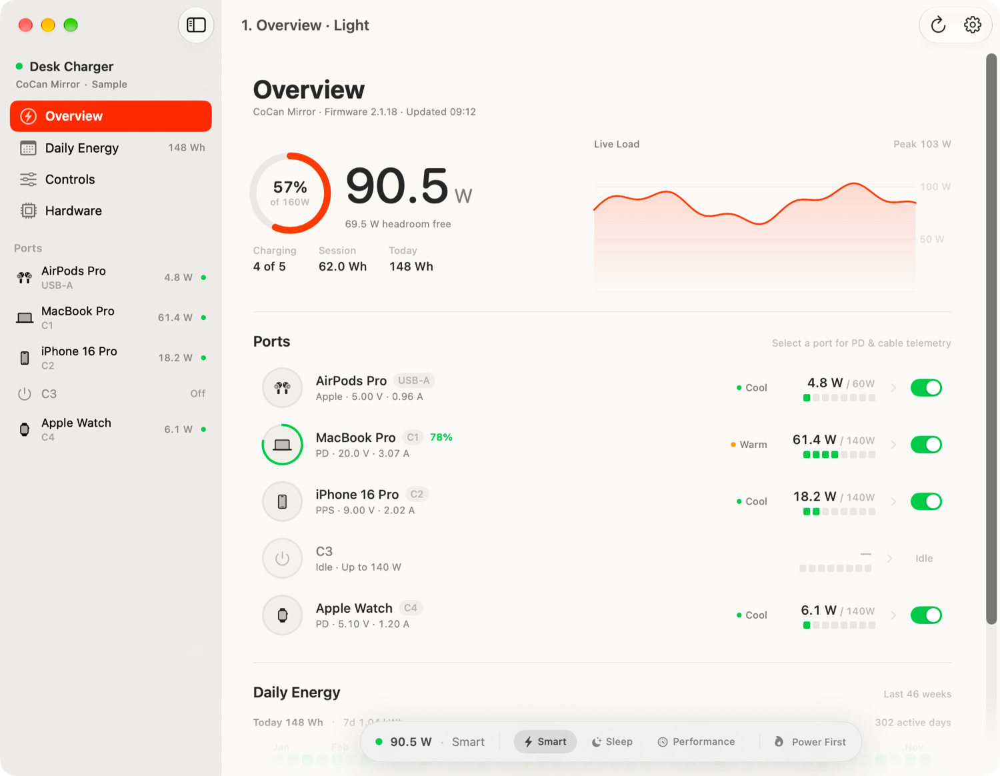
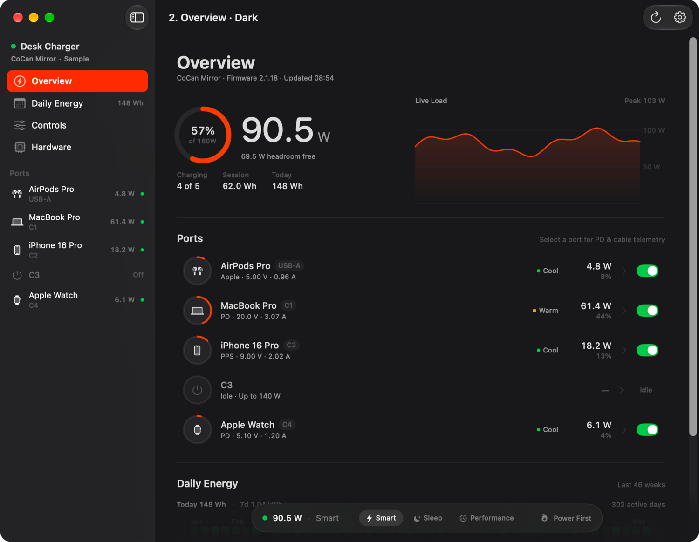
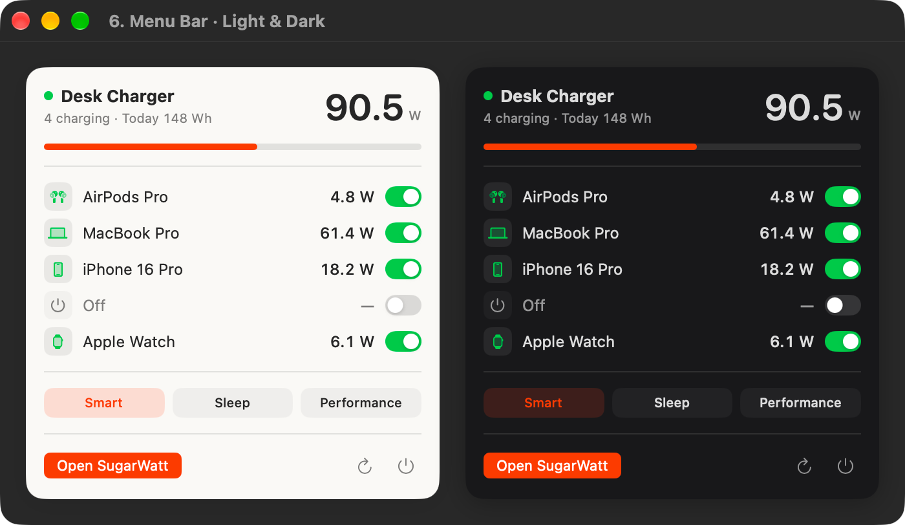
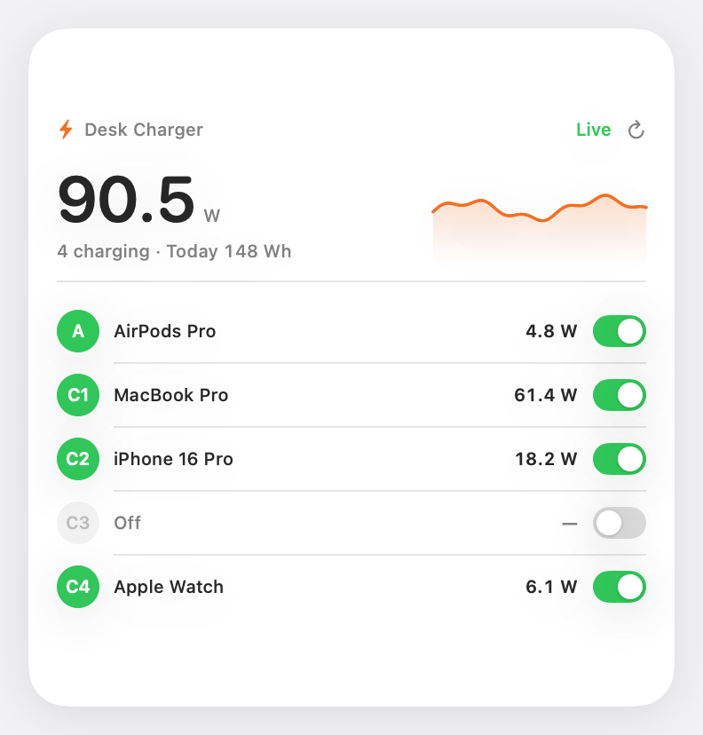
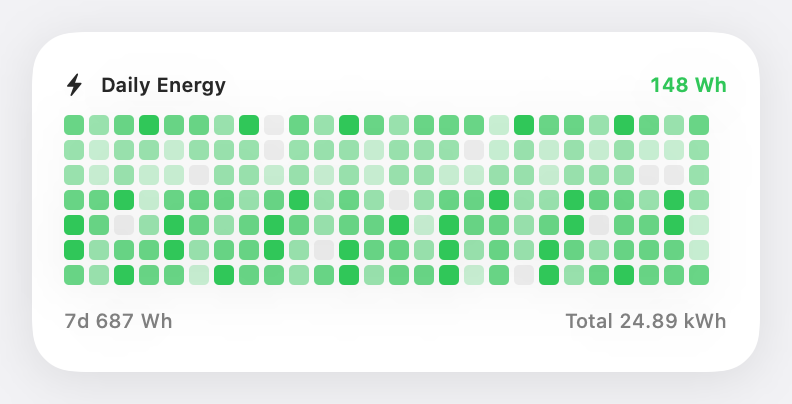
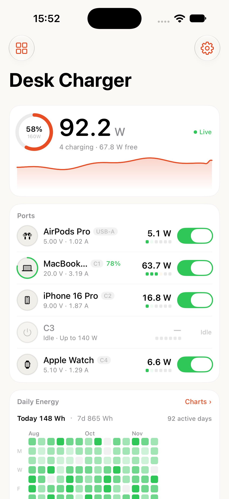
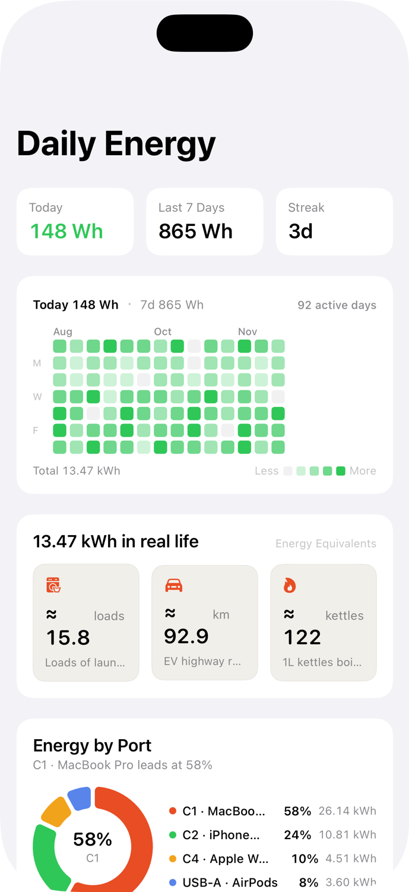
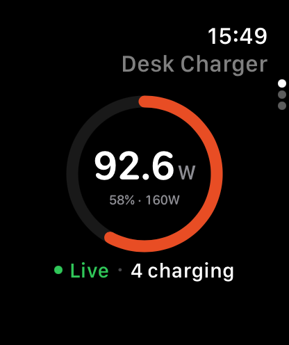
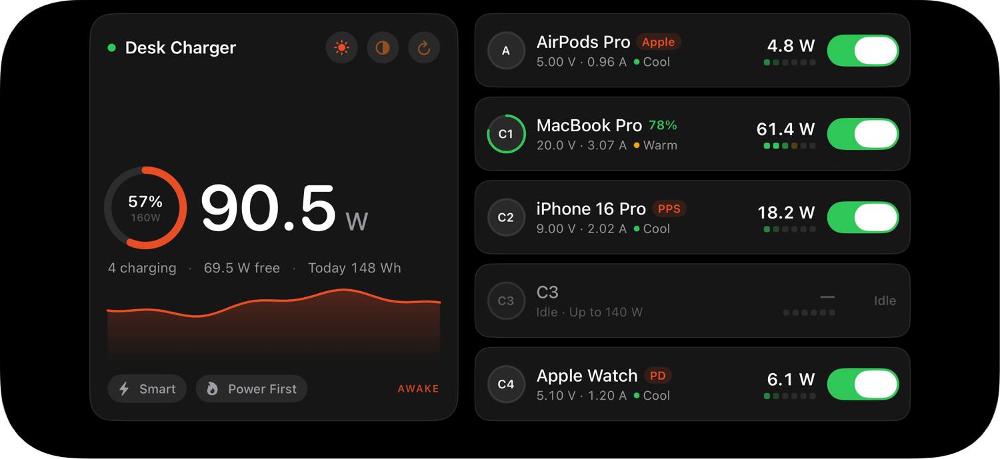
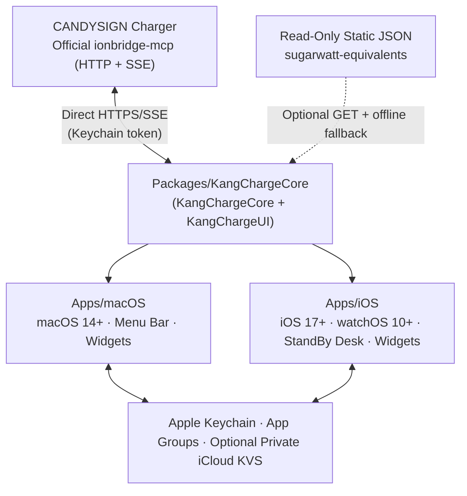

<div align="center">

# ⚡ SugarWatt

**An Apple-native macOS, iOS & watchOS companion suite for CANDYSIGN (制糖工厂) CoCan smart desk chargers.**

[](ARCHITECTURE.md)
[](Packages/KangChargeCore/Package.swift)
[](LICENSE)
[](ARCHITECTURE.md)

[macOS App](Apps/macOS) · [iOS & watchOS App](Apps/iOS) · [Shared SPM (`KangChargeCore`)](Packages/KangChargeCore) · [Architecture](ARCHITECTURE.md) · [Energy Equivalents JSON](https://github.com/LeiZiKang/sugarwatt-equivalents)

</div>

---

SugarWatt is an independent, MIT open-source SwiftUI suite that talks **directly** to your CANDYSIGN smart desk charger over its official `ionbridge-mcp` endpoint — no custom relay server, no user accounts, no firmware flashing, and no third-party analytics.

<p align="center">
  
</p>

## Visual Tour

### macOS · Dark Mode, Menu Bar & Desktop Widgets

| Dark Mode Dashboard | Menu Bar Presence |
| :---: | :---: |
|  |  |

| Large Interactive Power Widget | Daily Energy Heatmap Widget |
| :---: | :---: |
|  |  |

### iPhone & Apple Watch · Modular Board, StandBy Desk & Watch Companion

| iPhone Live Dashboard | Daily Energy Analytics | Apple Watch Companion |
| :---: | :---: | :---: |
|  |  |  |

<p align="center">
  
</p>

---

## Inside This Monorepo

Click any directory below to jump straight into its source code and documentation:

| Directory / Repo | Platform / Role | Highlights |
| --- | --- | --- |
| [**`Apps/macOS/`**](Apps/macOS) | macOS 14+ App & Desktop Widgets | Menu bar & Dock presence, live Swift Charts load curve, safe per-port switches, Shortcuts App Intents, Desktop WidgetKit suite |
| [**`Apps/iOS/`**](Apps/iOS) | iOS 17+ & watchOS 10+ Apps & Widgets | Modular `1×1` / `2×1` Widget Board, StandBy-style Landscape Desk Dashboard, Home/Lock Screen widgets, 3-page Digital Crown Watch app |
| [**`Packages/KangChargeCore/`**](Packages/KangChargeCore) | Shared Swift Package (`KangChargeCore` + `KangChargeUI`) | HTTP+SSE `ionbridge-mcp` client, typed USB-PD models, `EnergyLedger`, offline Demo simulator, shared SwiftUI components & unit tests |
| [**`ARCHITECTURE.md`**](ARCHITECTURE.md) | System Architecture & How It Works | End-to-end Mermaid diagram, data-flow walkthrough, App Group & optional iCloud KVS sync model |
| [**`sugarwatt-equivalents`**](https://github.com/LeiZiKang/sugarwatt-equivalents) | Community JSON Catalog (Public PRs) | Read-only `equivalents.json` turning raw `kWh` into intuitive comparisons (iPhone charges, espresso cups, EV km) with bundled offline fallback |

---

## Architecture & How It Works



- **Zero relay backend**: Paste your charger's MCP URL once; SugarWatt stores it strictly in your local **Apple Keychain** and polls your device directly over HTTP+SSE.
- **Instant offline Demo Mode**: No physical charger on hand? Toggle **Demo Mode** to explore realistic live multi-port wattage, charts, and widgets completely offline.
- **Single local Swift Package**: Both [`Apps/macOS`](Apps/macOS) and [`Apps/iOS`](Apps/iOS) depend directly on [`Packages/KangChargeCore`](Packages/KangChargeCore) via relative path — edit shared code once and both platforms update immediately.

Read the full walkthrough in **[ARCHITECTURE.md](ARCHITECTURE.md)**.

---

## Build from Source

**Requirements:** macOS 14+, Xcode 16+, and [XcodeGen](https://github.com/yonaskolb/XcodeGen) (`brew install xcodegen`).

```bash
git clone https://github.com/LeiZiKang/SugarWatt.git
cd SugarWatt

# 1. Run shared Swift Package unit tests
swift test --package-path Packages/KangChargeCore

# 2. Generate & open macOS app
cd Apps/macOS
cp Config/Local.xcconfig.example Config/Local.xcconfig
xcodegen generate && open KangCharge.xcodeproj

# 3. Generate & open iOS & watchOS app
cd ../iOS
cp Config/Local.xcconfig.example Config/Local.xcconfig
xcodegen generate && open KangChargeiOS.xcodeproj
```

> Fill in your Apple Developer `DEVELOPMENT_TEAM` (a free personal team works) and `BUNDLE_ID_PREFIX` inside `Config/Local.xcconfig` before running on physical hardware.

---

## Privacy & Disclaimer

- **No telemetry, no ads, no custom servers.** Your MCP URL contains your charger serial and access token and never leaves your Apple Keychain except to talk directly to your charger.
- Daily energy history stays in your local App Group and optionally syncs only through your private Apple iCloud Key-Value Store.
- SugarWatt is an independent open-source project and is not affiliated with, endorsed by, or sponsored by CANDYSIGN (制糖工厂).

## License

Released under the [MIT License](LICENSE).
